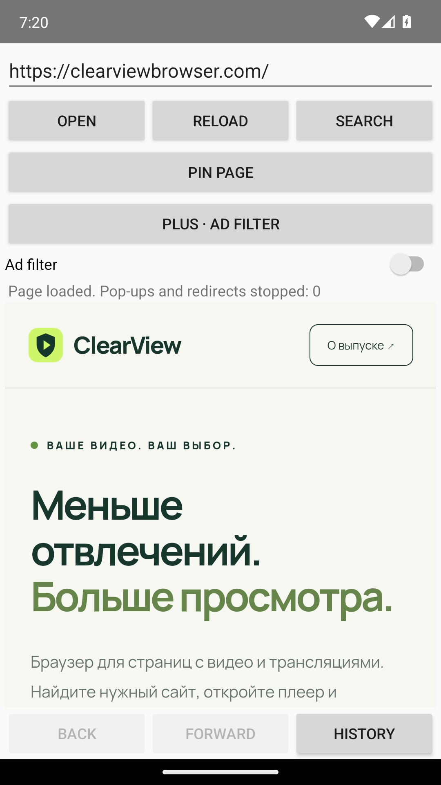
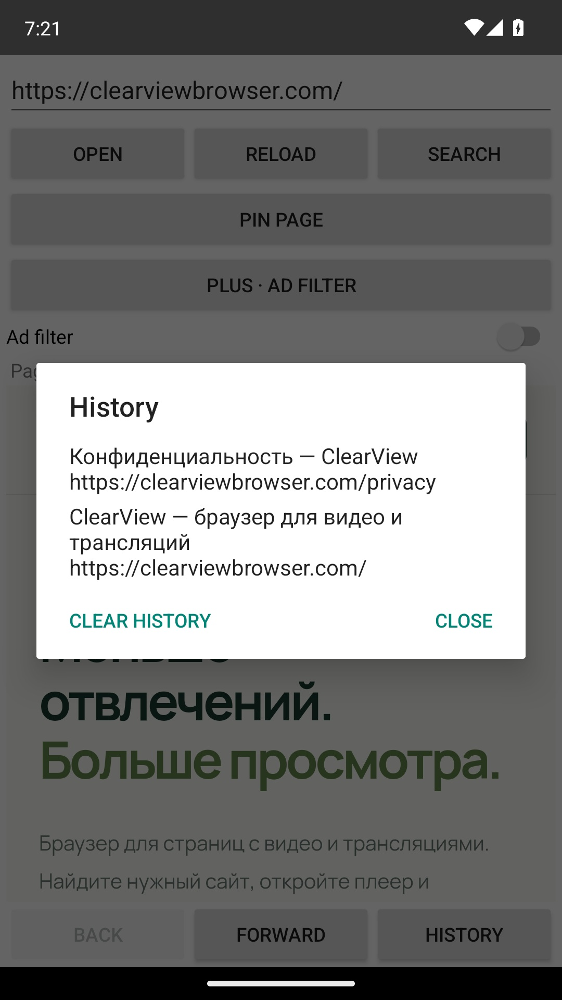

# ClearView: Video Browser

ClearView is an Android browser for watching video on the web. Pinning a page helps keep an unexpected pop-up or redirect from taking you away from the player. Browsing history stays on the device and can be cleared from the History dialog.

[Google Play](https://play.google.com/store/apps/details?id=org.clearview.prototype) · [Project website](https://clearviewbrowser.com/)

| Browser and page controls | On-device history |
| --- | --- |
|  |  |

## Engineering

I built the Android client in Kotlin with WebView. Its navigation policy handles new windows and redirects. The optional Plus subscription adds a filter for known advertising addresses.

I integrated Google Play Billing with a Node.js purchase-verification service on Google Cloud Run. Using a Pixel Fold and Google Play's billing test tools, I verified that subscription access survived an app restart after renewal and that a refund with revocation removed access to the paid filter.
